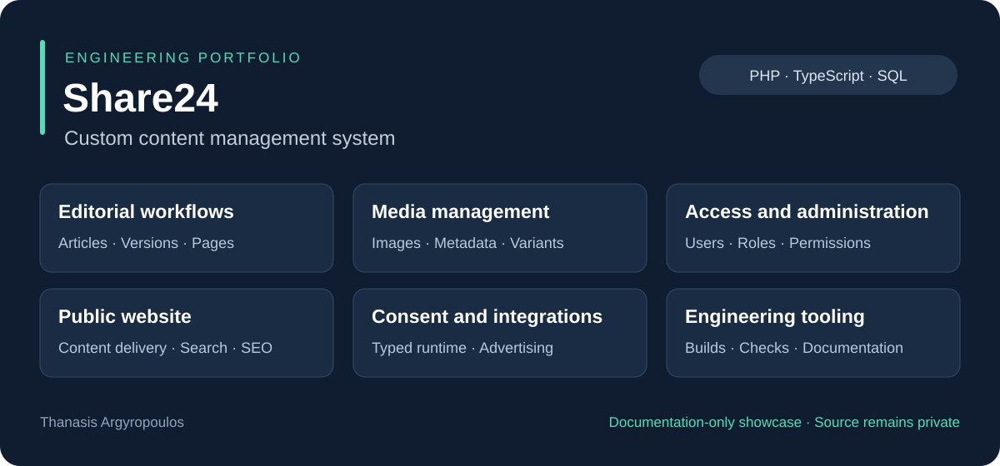

# Share24 — Custom Content Management System

**A custom publishing platform connecting editorial work, content management and public website delivery.**

**Developer:** Thanasis Argyropoulos · **Project:** Share24.gr  
**Core technologies:** PHP 8.2+ · TypeScript · JavaScript · SQL · HTML/CSS

> This repository is a documentation-only portfolio showcase. The commercial application's source code, internal file structure and database schema remain private. There is no installable application or runnable demo here.

## The project in 30 seconds

Share24 is a custom CMS for managing articles, pages, media and the website that presents them to readers. Its scope extends beyond publishing text: it includes content versions, structured content blocks, administrative permissions, imports, SEO, navigation, settings and consent-aware advertising integration.

This case study presents the scope of my development work and the engineering choices behind it, at a level suitable for recruiters and technical reviewers.

## What my work covers

- **Backend development:** object-oriented PHP with separate application, business and persistence responsibilities.
- **Editorial workflows:** article management, content versions, structured blocks, categories and tags.
- **Database-backed features:** relational storage and repository-based data access across CMS modules.
- **Frontend development:** public content presentation, browser interactions and a TypeScript consent runtime.
- **Integration work:** third-party libraries, localization, media handling and advertising/consent coordination.
- **Engineering tooling:** dependency management, automated checks and machine-readable architecture documentation.

## Selected capabilities

| Area | What it enables |
| --- | --- |
| Editorial administration | Manage articles, versions, pages and content organization |
| Media library | Manage image metadata, processing and image variants |
| Access management | Control administrative access through users, roles and permissions |
| Public website | Present articles, archives, categories, tags, pages and search |
| SEO and navigation | Manage metadata, structured data, sitemaps, redirects and menus |
| Consent and advertising | Coordinate consent preferences with site code and advertising behavior |
| Content imports | Ingest and transform source content into structured CMS content |

## Technology choices

| Technology | Role in the project |
| --- | --- |
| PHP 8.2+ | Custom backend and server-rendered content delivery |
| TypeScript | Typed browser-side consent state and provider integration |
| JavaScript, HTML and CSS | Public website and administrative interactions |
| SQL and relational storage | Persistent content, relationships and application configuration |
| Composer and Symfony Translation | PHP dependency management and localization support |
| npm, TypeScript compiler and esbuild | Frontend type checking and browser bundle generation |
| Git and GitHub Actions | Version control and a configured consent build/check workflow |
| Python | Supporting code/database indexing and architecture documentation tooling |

TypeScript has a specific role in the consent subsystem; this is not a claim that the entire frontend uses TypeScript. Node.js is a build-time tool rather than a requirement for serving the generated browser bundle.

## Explore the case study

- [Capabilities and user value](docs/CAPABILITIES.md)
- [Engineering overview](docs/ENGINEERING.md)
- [Quality practices and evidence boundaries](docs/QUALITY.md)
- [Ελληνική παρουσίαση](README.el.md)
- [Publication and ownership notice](NOTICE.md)

This showcase was prepared from a reviewed project snapshot on **25 October 2026**. It describes documented implementation scope, rather than certifying a live deployment or reporting a new test run. Detailed implementation, credentials and operational data are intentionally absent.
