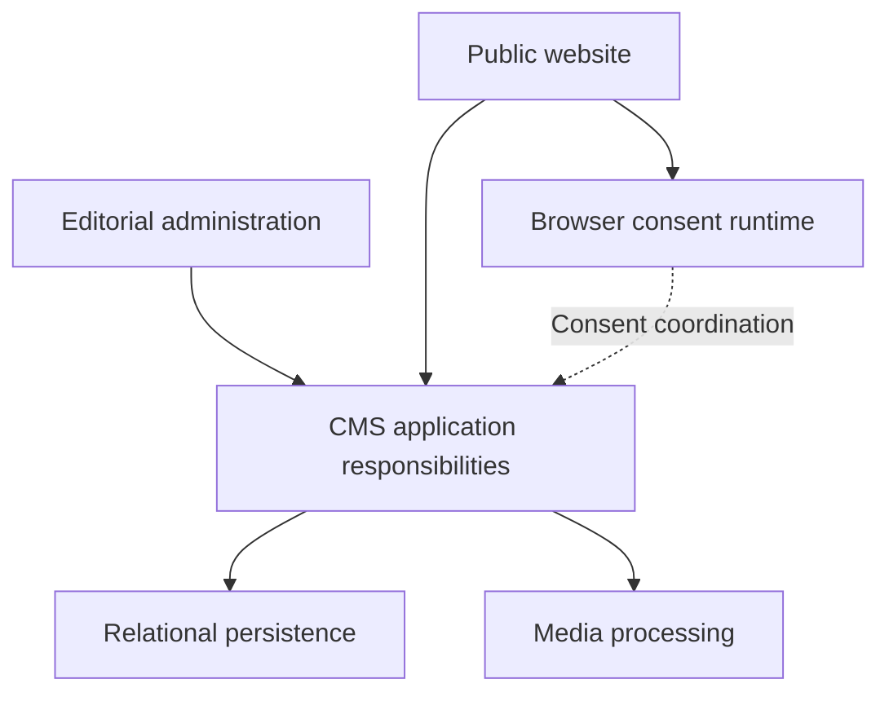

# Engineering overview

## A deliberately simplified view

The following diagram groups responsibilities for explanation. It does not reproduce internal directories, class names, database entities or deployment topology.

## Backend and data

The custom PHP backend separates request handling, business services and persistence responsibilities. Models and repositories support database-backed CMS features. This division makes it possible to discuss editorial behavior separately from SQL access and public presentation.

Relational storage supports content, taxonomy, media, permissions and configuration. The public showcase does not include table names, column definitions, relationships, migrations, queries or database exports.

## Browser behavior and build tooling

The consent subsystem uses TypeScript for typed state, storage, events and provider boundaries. An esbuild-based build generates its browser JavaScript. The wider interface also includes JavaScript and CSS assets for public presentation and administration.

Node.js supports the build process; generated JavaScript can be served by the PHP application without a Node.js application server.

## Dependencies and integration

The reviewed dependency manifest declares Symfony Translation through Composer. The reviewed frontend manifest declares TypeScript and esbuild as development dependencies. The asset inventory also records Bootstrap, TinyMCE, Swiper and Tom Select.

Those library names describe dependency and asset evidence. They do not imply that the entire backend uses Symfony, or that every inventoried asset is active on every page. No third-party library files are redistributed in this showcase.

## Supporting engineering tools

Python tooling documents code structure, groups application responsibilities and maps database usage. Machine-readable indexes help record relationships between the codebase and its data layer.

The public material communicates that documentation practice without publishing the indexes themselves. Source paths, class inventories, method signatures and database maps stay outside this repository.
